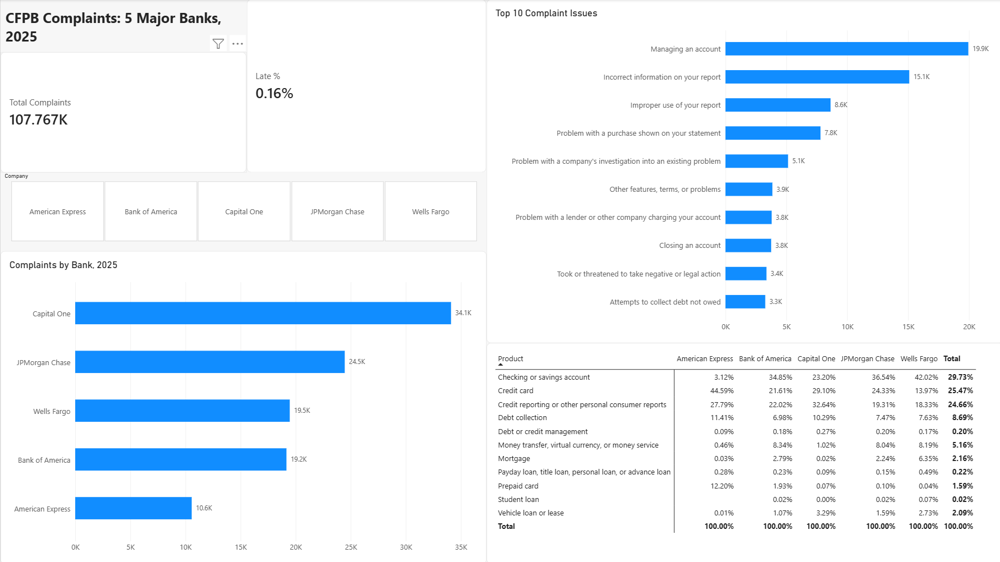

# CFPB Complaint Analysis: 5 Major US Banks (2025)

My first solo data project. I analyzed 107,767 consumer complaints filed with the CFPB in 2025 against Capital One, JPMorgan Chase, Wells Fargo, Bank of America, and American Express. I did the same analysis three times, in Excel, SQL, and Power BI, and checked that the numbers matched in all three.

## Questions
1. Which banks get the most complaints?
2. Which products and issues drive those complaints?
3. Which banks respond on time, and which don't?

## Findings
- **Capital One had the most complaints:** 34,102, or 31.6% of the total. That's about 40% more than JPMorgan Chase, even though Chase is the bigger bank. These are raw counts, not adjusted for customer size.
- **Three products made up about 80% of complaints:** checking/savings, credit cards, and credit reporting. Each bank's problem area was different. 42% of Wells Fargo's complaints were about checking/savings, 45% of Amex's were about credit cards, and Capital One's biggest category was credit reporting (33%).
- **Timeliness wasn't where the banks differed.** 99.84% of complaints got an on-time response. Amex had the highest late rate at 0.84%. JPMorgan Chase and Wells Fargo had zero late responses.

## Data
- Source: [CFPB Consumer Complaint Database archive](https://www.consumerfinance.gov/foia-requests/foia-electronic-reading-room/cfpb-consumer-complaint-database-narratives-archive/)
- The CFPB stopped publishing new complaints in August 2026, so I used the bulk archive files covering January to December 2025 (6 files, about 2.5 GB).
- The raw data isn't in this repo because of its size.

## Process
**Excel (Power Query + PivotTables)**
- Combined 6 CSV files with Power Query, filtered to the 5 banks and 2025 dates, and kept the 11 columns I needed.
- Found a data quality issue: some complaint narratives had line breaks that split one complaint into several broken rows, which dropped real complaints from my filter. Fixed it by setting Power Query to ignore line breaks inside quoted text. Errors went to 0%.
- Checked that every Complaint ID was unique (107,767 rows = 107,767 IDs).
- Built PivotTables and 3 charts, one per question.

**SQL (SQLite / DB Browser)**
- Loaded the cleaned data and rewrote each answer as a query: `GROUP BY`, `WHERE`, `ORDER BY`, `LIMIT`, subqueries for percentages, and `CASE WHEN` for the late-response rate.
- Every result matched the Excel numbers.

**Power BI**
- One-page dashboard with total complaints, late %, complaints by bank, top 10 issues, product mix by bank, and a bank filter.
- Wrote a DAX measure for late % using `CALCULATE` and `DIVIDE`.

## Files
| File | What it is |
|---|---|
| `cfpb_analysis.sql` | All SQL queries, commented |
| `CFPB_Analysis.xlsx` | PivotTables, charts, and written findings |
| `CFPB_Dashboard.pbix` | Interactive dashboard (download and open in Power BI Desktop) |
| `cfpb_dashboard.png` | Dashboard screenshot |

## Limitations
- Counts aren't adjusted for how many customers each bank has, so more complaints doesn't automatically mean a worse bank.
- CFPB complaints are self-reported and not verified.
- Capital One and Amex are card-heavy, while the others are full-service banks, so their product mixes aren't directly comparable.

## Tools
Excel (Power Query, PivotTables) · SQL (SQLite) · Power BI (DAX)
